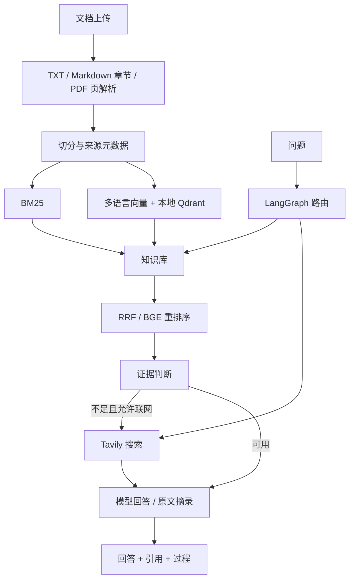

# AI Docs Agent

本地运行的 AI 技术文档知识库：上传 TXT / Markdown / PDF，使用向量与 BM25 混合检索、BGE 重排序和 LangGraph 路由，查看带来源的答案、检索过程和实测评测。

## 启动

项目：`D:\workprojects\ai-docs-agent`。Conda 环境：`AIDocsAgent_py312`（Python 3.12.15）。

在 VS Code 中选择这个环境，打开 **app.py**，点击 ▶。浏览器打开 **http://127.0.0.1:8008**。应用已运行时会打开现有页面。

```powershell
cd D:\workprojects\ai-docs-agent
conda activate AIDocsAgent_py312
python app.py
```

也可运行 `start.ps1`，它使用环境的绝对 Python 路径。关闭服务时在启动终端按 Ctrl+C。应用仅监听本机，Qdrant 为本地持久化模式；使用一个进程、一个 worker，避免两个应用进程同时访问同一索引。

当前由助手启动的后台服务可以通过项目内的 `stop.ps1` 停止；脚本先核对 PID 对应的解释器与命令，避免停止其他程序。

## 网页操作

1. 左侧上传参考文档，单文件最多 10 MB、每次最多 10 个。上传后自动后台建立索引；进度与失败信息在左侧显示。
2. 提问时选择 BM25、向量、RRF 混合或混合加重排序；选择自动路由、仅知识库或联网；可返回 3 / 5 / 8 个片段。
3. 点击回答中的 `[1]` 等引用定位来源。展开证据面板查看 Top-K 候选、文件行号 / PDF 页码 / 字符偏移、原文与分数，打开原文件或官方来源。
4. 展开“处理过程”查看路由、检索、证据判断和回答节点。
5. “检索评测”页显示实测结果。文档变化后会提示评测对应的索引已过期。

未配置模型时，主回答框明确展示**排名第一的原文摘录**，其余候选保留在证据面板。它不会伪装成生成式总结。扫描 PDF 暂不做 OCR，会提示先完成 OCR。

## 模型与搜索

网页左下角“模型与搜索设置”会把配置保存在本机 `.env`，也可以直接编辑该文件。密钥不通过状态接口返回；`.env` 已加入 Git 忽略。

```dotenv
LLM_BASE_URL=https://api.deepseek.com
LLM_MODEL=deepseek-flash
LLM_API_KEY=你的本地密钥
TAVILY_API_KEY=你的本地搜索密钥
ANSWER_MODE=auto
```

DeepSeek 使用 `/chat/completions` 接口。可以改成其他兼容服务的地址和模型。需要 API 平台凭据，网页聊天账号不会自动提供 API 权限。

- `auto`：有模型配置时判断证据充分性并生成引用回答；否则摘录原文。
- `extractive`：仅显示原文，不调用生成模型。
- `llm`：要求模型回答，缺密钥时明确提示。
- Tavily 未配置时，实时问题显示配置提示，不编造搜索结果。

没有用户 API 密钥时，外部服务的真实调用无法验收。请求格式、错误处理、数字引用验证与联网回退通过模拟服务测试；本地模型、检索接口、上传链路和网页已实际运行。数字引用检查只验证编号范围，不代表每条事实都已被证明，仍需核对原文。

## 架构与实际范围



路由使用时间关键词规则，并允许手动覆盖。配置模型时，证据充分性由模型判断；没有模型时使用透明的词汇/候选分数检查，不宣称答案已充分验证。每个查询独立，网页历史仅用于展示，没有跨会话记忆。

默认向量模型是 `sentence-transformers/paraphrase-multilingual-MiniLM-L12-v2`（384 维），以较小模型支持中英技术文档和本地 CPU 运行。这里没有使用 BGE-M3。更换向量模型须确认 FastEmbed 支持、重启应用并重建索引。

重排序是 `BAAI/bge-reranker-base`，CPU 4 线程、每批 2 个候选。默认切分 350 字符、重叠 60 字符，优先寻找段落/句子边界。字符数不同于 token 数；模型版本、ONNX SHA-256 与本次语料长度检查保存在 `data/model-manifest.json`。

索引先建立新的 Qdrant collection，再原子替换索引清单；失败时保留旧索引，成功后清理旧 collection。索引任务在后台执行，上传期间的新更新会排队。文档文件与索引状态分别显示，索引失败后可重试。

## 阅读入口

```text
app.py                        点击运行入口
main.py / search.py            保留的原始切分、BM25 练习
tokenize_demo.py               保留的分词练习
src/ai_docs_agent/
  documents.py                解析、切分与来源
  retrieval.py                BM25 / Dense / RRF / Reranker
  providers.py                模型 API、证据判断和 Tavily
  graph.py                    LangGraph 状态、节点和路由
  jobs.py                     后台索引任务
  api.py                      FastAPI
  web/                        HTML / CSS / JavaScript 网页
data/documents/               实际语料（不提交 Git）
data/index/                   持久化索引（不提交 Git）
data/models/                  模型缓存（不提交 Git）
data/sources.json             官方原文 commit、URL、SHA-256
evals/                       标注、指标与实际结果
tests/                       关键行为测试
docs/graph.mmd               运行中的实际图导出
references/                  来源仓库许可证
```

建议阅读顺序：原来的 `search.py` → `documents.py` → `retrieval.py` → `graph.py` → `providers.py` → `api.py` → `web/app.js`。

API 文档：**http://127.0.0.1:8008/docs**。关键接口包括 `/api/health`、`/api/upload`、`/api/ingest`、`/api/jobs/{id}`、`/api/retrieve`、`/api/query`、`/api/settings`。

## 实测与复现

开发集有 24 个按官方原文片段标注的问题，标签在检索测量前生成，包含重叠 chunk 的多个正例。它没有独立人工复核，不代表通用基准、生产 SLA 或招聘水平。

保持应用运行，然后执行：

```powershell
python evals/build_dataset.py
python evals/evaluate.py --repeats 2
```

评测使用独立的 `/api/retrieve`，不调用生成模型或搜索。每种方法先预热，每题重复两次，候选 20、Top-5。Hit@5 表示至少命中一个正例；Recall@5 是标注正例召回比例；MRR@5 是第一个正例的排名；nDCG@5 衡量多个正例的排序。P50/P95 为本机 HTTP 检索接口耗时，排除下载和预热。

原始排名与指标在 `evals/results.json`，简表在 `evals/results.md`。各方法完成后立即保存；失败会记录并退出非零状态。

```powershell
python -m pytest tests -q
python -m ruff check src tests scripts evals app.py --config pyproject.toml
python -m pip check
```

`scripts/verify_application.py` 通过真实 HTTP 验证四种检索、上传、索引、来源与删除专用测试文件，会改变索引 revision；运行它之后重新生成评测标注与结果。

新电脑进入项目目录后：

```powershell
conda env create -f environment.yml
conda activate AIDocsAgent_py312
python scripts/fetch_documents.py
python app.py
```

在网页点击“重新建立索引”。`requirements-lock.txt` 保存本次 Windows / Python 3.12 环境的实际依赖版本。文档下载使用 pinned URL 和 SHA-256，拒绝覆盖被本地修改的同名文档。首次模型下载需要联网；缓存保留后，本地检索可离线运行。

## 官方资料

- [LangGraph Graph API](https://docs.langchain.com/oss/python/langgraph/graph-api)
- [FastEmbed 支持模型](https://qdrant.github.io/fastembed/examples/Supported_Models/)
- [DeepSeek API](https://api-docs.deepseek.com/guides/codex)
- [Tavily Search](https://docs.tavily.com/documentation/api-reference/endpoint/search)
- [MiniLM 模型卡](https://huggingface.co/sentence-transformers/paraphrase-multilingual-MiniLM-L12-v2)
- [BGE Reranker 模型卡](https://huggingface.co/BAAI/bge-reranker-base)

这是完整的本地学习与展示版本。尚未实现 OCR、账号、多用户部署、跨会话记忆或大规模检索优化。根据评测再选择方案，不假设增加模块一定提升所有问题。

